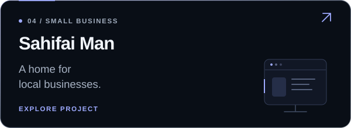
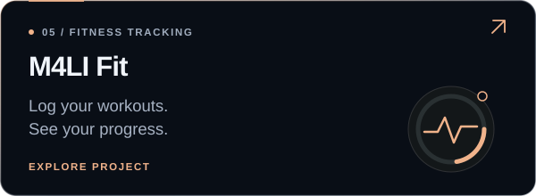
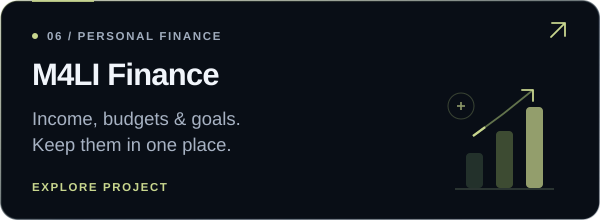

  <a href="https://m4li.de/">
    <picture>
      <source media="(prefers-reduced-motion: reduce) and (max-width: 600px)" srcset="hero-mobile-static.svg">
      <source media="(prefers-reduced-motion: reduce)" srcset="hero-static.svg">
      <source media="(max-width: 600px)" srcset="hero-mobile.svg">
      
    </picture>
  </a>

  <a href="https://m4li.de/"><strong>Portfolio ↗</strong></a> &nbsp; · &nbsp;
  <a href="https://www.linkedin.com/in/muhammadali-rahimov-3ab2b436b/"><strong>LinkedIn ↗</strong></a> &nbsp; · &nbsp;
  <a href="https://github.com/rahimovM4li?tab=repositories"><strong>Repositories ↗</strong></a>

## A little about me

I'm **Ali**, a software developer based in **Passau, Germany**, originally from Tajikistan. I'm in the **third year of my apprenticeship in application development at msg systems ag**, with completion planned for **summer 2027**.

I build web applications across the stack: interfaces, backend services, databases and deployment. At work, I contribute to enterprise applications using **Angular, Java and Spring Boot**, including features that integrate **LLMs and semantic search**. Outside work, I build my own products around learning, everyday tools and digital experiences.

**My current focus:** full-stack engineering, practical AI integration and turning ideas into applications people can use.

## Selected projects

<table>
  <tr>
    <td width="50%" valign="top">
      
      
Personalized digital invitations with templates, photos, music and mobile sharing.

      
React · TypeScript · Supabase · PostgreSQL

      <a href="https://davatnoma.m4li.de/"><strong>Explore Davatnoma ↗</strong></a>
    </td>
    <td width="50%" valign="top">
      
      
Exam preparation for IT apprentices, with simulations, SQL and pseudocode practice, and offline learning.

      
React · TypeScript · PWA · IndexedDB

      <a href="https://coach.m4li.de/"><strong>Open Exam Coach ↗</strong></a>
    </td>
  </tr>
  <tr>
    <td width="50%" valign="top">
      
      
A multilingual guide to studying, working and living in Germany, built for people from Tajikistan.

      
React · TypeScript · Internationalization

      <a href="https://roadmap.m4li.de/"><strong>Explore the roadmap ↗</strong></a>
      &nbsp; · &nbsp; <a href="https://github.com/rahimovM4li/raodmap.de">Source</a>
    </td>
    <td width="50%" valign="top">
      
      
A template-based platform for small businesses to present their services, prices, location and contact options.

      
Spring Boot · PostgreSQL · Responsive web

      <a href="https://www.sahifai-man.tj/"><strong>Visit Sahifai Man ↗</strong></a>
    </td>
  </tr>
  <tr>
    <td width="50%" valign="top">
      
      
A mobile workout tracker for exercises, sets, reps and weight, with charts to follow progress.

      
React · TypeScript · PWA · Firebase

      <a href="https://fit.m4li.de/"><strong>Explore M4LI Fit ↗</strong></a>
      &nbsp; · &nbsp; <a href="https://github.com/rahimovM4li/m4li-fitness-tracker">Source</a>
    </td>
    <td width="50%" valign="top">
      
      
A personal finance tracker for income, expenses, budgets and savings goals, with visual insights.

      
React · TypeScript · PWA · Firebase

      <a href="https://finance.m4li.de/"><strong>Explore M4LI Finance ↗</strong></a>
      &nbsp; · &nbsp; <a href="https://github.com/rahimovM4li/m4li-finance-tracker">Source</a>
    </td>
  </tr>
</table>

  <a href="https://m4li.de/"><strong>More projects, case studies and the story behind them → m4li.de</strong></a>

## Technologies I work with

| Area | Technologies |
| :--- | :--- |
| **Frontend** | Angular · React · Next.js · TypeScript · Tailwind CSS |
| **Backend & data** | Java · Spring Boot · REST APIs · PostgreSQL · SQL |
| **AI integration** | LLM APIs · RAG · embeddings · semantic search · pgvector |
| **Delivery & tooling** | Docker · Git · GitHub / GitLab · CI/CD · Linux · Nginx |

## Beyond the public demos

- **AgentHub** — a learning platform for agentic development, combining courses, an AI assistant and community features.
- **Kalima** — a vocabulary-learning app built around spaced repetition.
- **Developer workflows** — exploring how specifications, user stories and acceptance criteria can guide AI-assisted implementation and testing.

  
<strong>A bit more about the person behind the code</strong>

   

  
I enjoy connecting design and engineering: understanding a problem, building something useful and refining the details that make it feel good to use.

  
<strong>Languages:</strong> Tajik (native) · Russian (fluent) · German (C1) · English (B1, working toward B2).

  
I also share projects, experiments and parts of my development journey on <a href="https://www.instagram.com/m4li.de/">Instagram</a> and <a href="https://www.youtube.com/@m4li_de">YouTube</a>.

## Let's connect

I'm happy to connect with developers and teams working on useful products, thoughtful interfaces and practical applications of AI.

**[LinkedIn](https://www.linkedin.com/in/muhammadali-rahimov-3ab2b436b/) · [Portfolio](https://m4li.de/) · [Instagram](https://www.instagram.com/m4li.de/) · [YouTube](https://www.youtube.com/@m4li_de)**

  

